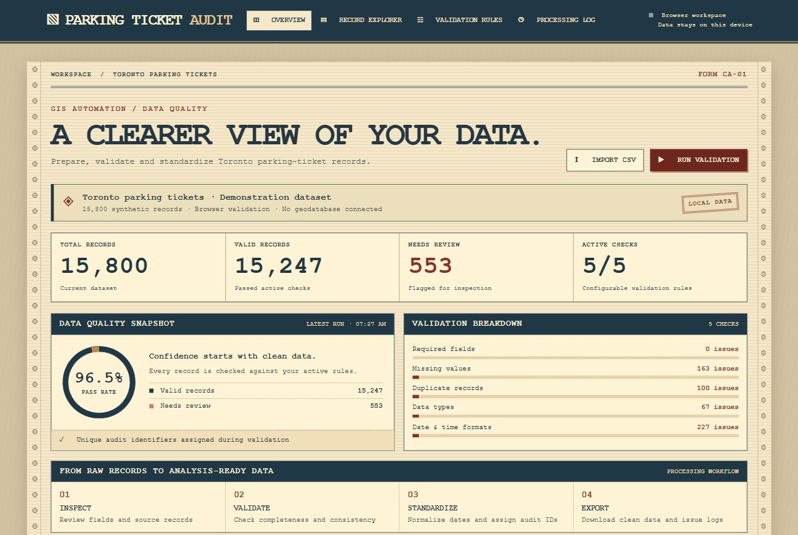
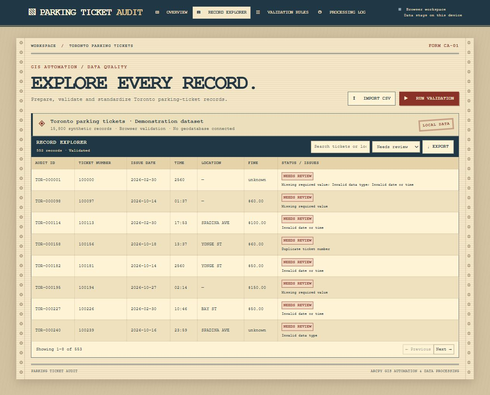

# Parking Ticket Audit

A browser app for validating Toronto parking ticket records, with a companion ArcPy script for ArcGIS Pro.

## Open the app

Open [app/index.html](app/index.html) in your browser. Select **Run validation** to try the included synthetic records, or select **Import CSV** to use a prepared file. No installation or web server is required.

## Screenshots

Both screenshots use the app's built-in synthetic records.

**Validation dashboard.** Run the checks to see the pass rate, flagged record count, and breakdown by rule.

**Record explorer.** Choose **Needs review** to inspect individual flags and export the filtered records.

## Project layout

| Path | Contents |
| --- | --- |
| app/ | Browser app, vintage citation styling, and ArcPy companion script |
| data/raw/parking-tickets-2024/ | The 12 original monthly CSVs from the City of Toronto |
| data/prepared/ | Working copies and samples ready to import |
| exports/ | Save audit exports and issue logs here |

## Reading the code

1. Start with [index.html](app/index.html) to see the page structure and controls.
2. Read [app.js](app/app.js) to follow the browser workflow. The demo or an imported CSV supplies records, validation adds audit fields, and the filtered records can be exported as CSV.
3. Open [style.css](app/style.css) to see how the theme, panels, and smaller-screen layouts are styled.
4. Read [arcpy_audit.py](app/arcpy_audit.py) for the separate ArcGIS Pro workflow. It checks the input fields, copies the source, audits the copy one row at a time, and writes an issue log.

## Use the City data

1. Copy a monthly CSV from data/raw/parking-tickets-2024/ to data/prepared/. For a quick run, keep the header and about 15,800 rows.
2. In the copy, rename the tag_number_masked header to ticket_number and location2 to location. Keep date_of_infraction, time_of_infraction, and set_fine_amount.
3. Import the copy. Disable **Data types** for this run because the City masks ticket IDs and the app checks for digits. This also disables the fine amount type check. A repeated masked ID is a review candidate, since masking can cause different tickets to share a value.
4. Run validation. Save record exports and the issue log in exports/.

Source: [City of Toronto Open Data — Parking Tickets](https://open.toronto.ca/dataset/parking-tickets/).

## Audit a CSV with regular Python

[app/csv_audit.py](app/csv_audit.py) uses only Python's built-in libraries. It accepts both City headers and the prepared CSV headers. In PyCharm, run the current file with no parameters to audit data/prepared/tickets.csv. Each run writes a new, timestamped pair of CSVs in exports/. To specify your own input and output paths, run this from the project directory:

~~~powershell
python app/csv_audit.py data/prepared/tickets.csv exports/tickets_audited_csv.csv exports/csv_validation_issues.csv
~~~

To sample the raw January file directly, use:

~~~powershell
python app/csv_audit.py data/raw/parking-tickets-2024/Parking_Tags_Data_2024_1.csv exports/january_audited.csv exports/january_issues.csv --limit 15800
~~~

Create the exports folder first if it is missing. The first output keeps every source record and adds audit fields. The second lists only records needing review. Repeated masked IDs get a note, and exact source-row matches still need review. Outputs must have new names. This workflow writes CSV files and requires neither an ArcGIS license nor a geodatabase.

## ArcGIS Pro

The [ArcPy script](app/arcpy_audit.py) takes a table or feature class, an existing output file geodatabase, an output name, and a CSV log path. Its docstring lists the required fields and invocation. Run it with ArcGIS Pro's licensed Python environment. Numeric and Toronto-style masked IDs are accepted. Repeated masked IDs appear in AUDIT_NOTE. A repeat in a table is flagged for review if its comparable source fields also match. AUDIT_ID is the unique identifier assigned to each audited row.

## Local files

The repository contains source code and a synthetic browser demo. The City CSVs, prepared data, geodatabases, audit exports, virtual environments, and editor settings stay local. Create the data and exports folders as needed when setting up a fresh clone.